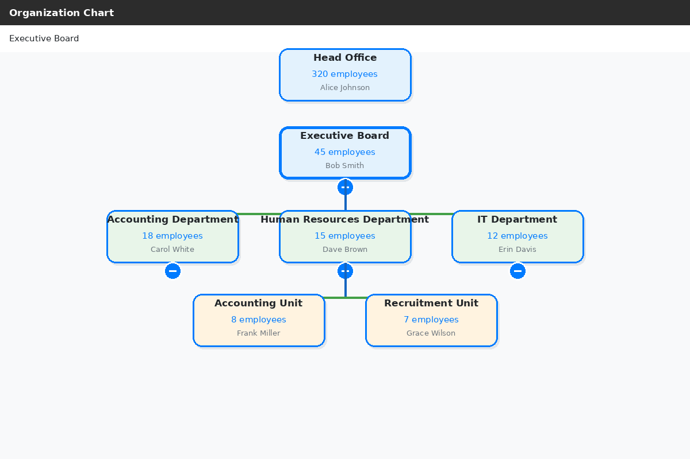
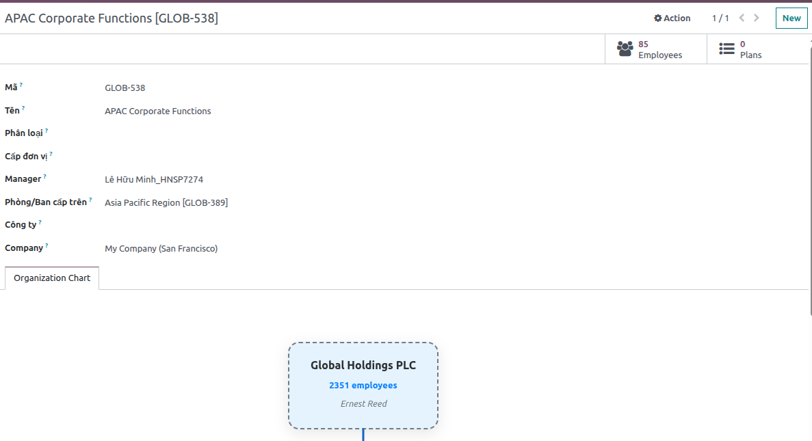

# HR Department Organization Chart

[](https://www.gnu.org/licenses/lgpl-3.0.en.html)
[](https://www.odoo.com)
[](https://github.com/Thanhtuyen12/widget-odoo)

An interactive organizational chart for `hr.department`, rendered as a tab on the department form.



---

## The problem

Odoo ships departments as a flat list with a `Parent Department` field. Answering "who reports to whom" means opening records one by one, or reading the tree view and holding the hierarchy in your head. Neither scales past a few dozen departments.

This module draws that hierarchy.

## What you get

The **Organization Chart** tab shows the department you are looking at in context:

```
        Head Office
             |
    Technology Division
             |
    Software Department      <- the record you have open
        /        \
Development     Quality Assurance
```

- Parent departments stack above, from the root down to the immediate parent.
- The current department sits in the middle with a highlighted border.
- Sub-departments fan out below, one row per level.

Every box shows the department name, its headcount, and its manager. Box colours rotate through a pastel palette by depth, so the level of a department is readable at a glance.



## Features

- **Two-way hierarchy** — ancestors above, descendants below.
- **Expand and collapse** — one click on a branch, at any depth.
- **Smart collapsing** — opening a branch closes its siblings at the same level, keeping wide orgs legible.
- **Live connectors** — SVG lines are recomputed on expand, collapse and window resize, so they always land exactly on the boxes.
- **Single query** — the whole subtree is fetched in one request, then assembled in the browser.
- **No configuration** — install it and the tab is there.
- **Reusable widget** — the chart is a standard field widget, so you can drop it into your own views.

## Requirements

- Odoo 16.0
- `hr` (Human Resources) — part of Odoo core

No third-party dependency.

## Installation

### From the Apps UI

1. Enable developer mode: *Settings → General → Developer Mode*.
2. Go to *Apps* and search for **HR Department Organization Chart**.
3. Click **Install**.

### From the command line

```bash
odoo -d <your_database> -i hr_department_org_chart --stop-after-init
```

To update an existing installation:

```bash
odoo -d <your_database> -u hr_department_org_chart --stop-after-init
```

Regenerate the web assets afterwards: *Apps → Update Apps List*, then **Upgrade** on the module.

## Usage

*Employees → Configuration → Departments*, open a department, switch to the **Organization Chart** tab.

Click the round **+** button below a box to reveal its direct sub-departments, and **−** to fold the branch back up.

## Using the widget in your own view

The widget is registered under the name `hr_department_org_chart`. It renders the hierarchy around the record it is attached to, so that record must be a department:

```xml
<field name="child_ids"
       widget="hr_department_org_chart"
       readonly="1"
       nolabel="1"
       options="{'no_open': True}"/>
```

## Permissions

Departments are read with the rights of the current user. Internal users have read access to `hr.department` by default, so the chart works out of the box. A user without access sees an explicit message in the tab rather than an empty chart.

## Performance

The subtree is retrieved with a single `searchRead` using the `child_of` operator, and the ancestor chain is resolved from the stored `parent_path` in one more query. The tree is then assembled client-side.

On a database with 650+ departments the chart renders in well under a second. The earlier implementation issued one request per node and took several minutes.

## Compatibility

The module attaches to `hr.department` through the `//group[@col='4']` anchor rather than `//sheet`, so it keeps working when another addon replaces the form's sheet element. Installing it alongside another organizational chart addon results in two tabs; deactivate the one you do not need.

Multi-company databases are supported. Departments follow the standard record rules, so each user sees the hierarchy they are allowed to read.

## Known limitation

The headcount comes from `hr.department.total_employee`, which counts employees directly assigned to the department. Employees in sub-departments are not rolled up into the parent's figure.

## Support

Open an issue on [GitHub](https://github.com/Thanhtuyen12/widget-odoo/issues).

## License

LGPL-3. See [LICENSE](hr_department_org_chart/LICENSE).

## Credits

- Author: Tuyen Fung
- Maintainer: Thanhtuyen12
