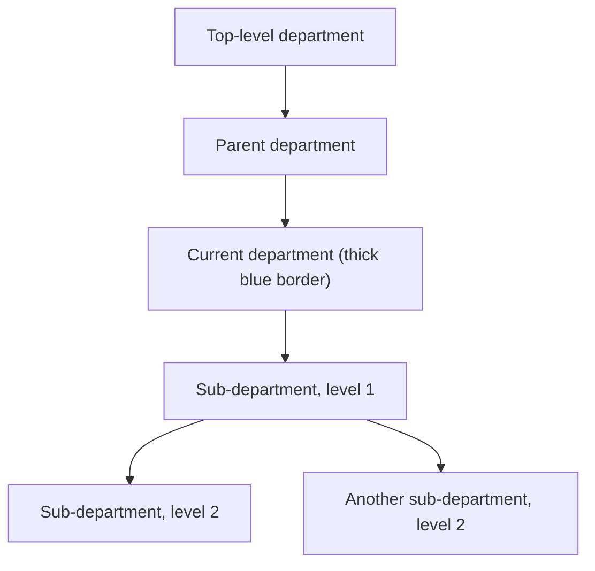

# Usage guide — HR Department Organization Chart

> **Module:** `hr_department_org_chart` — *HR Department Organization Chart*
> **Version:** Odoo 16.0 · **License:** LGPL-3 · **Author:** Tuyen Fung

---

## 1. Overview

The module adds an **"Organization Chart"** tab to every **department** form
(`hr.department`). When you open this tab, the full departmental network around
the department you are looking at is displayed in three parts:



* **Above** — the chain of **parent departments** (from the highest level down
  to the direct parent).
* **In the middle** — the **current department**, highlighted with a thick blue
  border.
* **Below** — the **tree of sub-departments**, one row per level, collapsible
  branch by branch.

Each box displays three pieces of information:

| Information | Source field |
|---|---|
| Department name | `name` |
| Number of employees | `total_employee` |
| Department manager | `manager_id` |

> The module **requires no configuration**. Install it and it works.

---

## 2. Installation

### 2.1. Requirements

* Odoo **16.0**
* The `hr` module (*Human Resources* application) — shipped with Odoo core

### 2.2. Install from the UI

1. Go to **Apps**.
2. Enable **Developer Mode**: *Settings -> General -> Developer Mode*.
3. Search for `HR Department Organization Chart`.
4. Click **Install**.

### 2.3. Install from the command line

Add the module directory to your `addons_path`, then run:

```bash
odoo -d <your_database> -i hr_department_org_chart --stop-after-init
```

### 2.4. Updating

```bash
odoo -d <your_database> -u hr_department_org_chart --stop-after-init
```

After an update, refresh the web assets:
*Apps -> Update Apps List*, then click **Upgrade** on the module.

---

## 3. Usage

### 3.1. Open the chart

1. Go to **Employees -> Configuration -> Departments**.
2. Click a department to open it in form view.
3. Switch to the **"Organization Chart"** tab.

### 3.2. Read the chart

* The boxes **above** are the parent departments, stacked from the top level
  down to the direct parent.
* The **highlighted box in the middle** is the department you are currently
  looking at.
* The boxes **below** are the sub-departments, one row per level.

The **background colour** of each box depends on its depth in the hierarchy
(rotating through 6 pastel shades), so you can immediately tell which level a
department belongs to.

> **Note:** the employee count comes from the `total_employee` field of the
> department, which only counts the employees **directly attached** to it. It
> does not aggregate the employees of its sub-departments.

### 3.3. Expand and collapse branches

* Click the round **+** button at the bottom of a box to reveal its direct
  sub-departments.
* Click the **-** button to collapse the branch again.

**Smart collapsing:** when you open a new branch, the branch that was
previously open at the same level is **collapsed automatically**. This keeps the
chart compact and readable, even when the organisational structure is complex.

The buttons are keyboard accessible (focusable) and expose an `aria-label` for
screen readers.

### 3.4. Connectors

The connectors are drawn with **SVG** and are automatically recomputed whenever:

* you expand or collapse a branch,
* you resize the browser window,
* the web fonts finish loading (if any).

The connectors therefore always match the exact position of the boxes.

---

## 4. Using the widget in your own view (advanced)

The widget is registered under the name `hr_department_org_chart`, so you can
reuse it on any relation pointing to `hr.department`:

```xml
<field name="child_ids"
       widget="hr_department_org_chart"
       readonly="1"
       nolabel="1"
       options="{'no_open': True}"/>
```

The widget always draws the hierarchy **around the record it is attached to**,
so that record must be a department.

---

## 5. Permissions

The widget reads `hr.department` data with the rights of the current user.

* Internal users have read access to *Departments* by default in Odoo, so the
  chart works out of the box.
* If a user has **no** read access, the tab displays an explicit warning
  message instead of throwing a JavaScript error.

---

## 6. Compatibility

If your database already has another module that adds its own organizational
chart tab to the department form (for example a company-specific addon), you
will see **two tabs**. To clean this up, go to *Settings -> Technical -> User
Interface -> Views* and deactivate the tab you do not need.

`hr_department_org_chart` **does not depend on** and **does not modify** any
other module, so it can safely be installed side by side.

---

## 7. Frequently asked questions

**The chart is empty / no sub-departments are shown?**
The department really has no child department. Check the *Parent Department*
(`parent_id`) field of the departments you expect to see.

**I see two organization chart tabs.**
See section 6.

**The employee count shows 0 although the department has employees?**
`total_employee` only counts the employees **directly assigned** to the
department. Check the *Department* field on the employee records.

**Does the module work with multi-company databases?**
Yes. Departments are filtered by the standard record rules of `hr.department`;
a user only sees the departments they are allowed to read.
